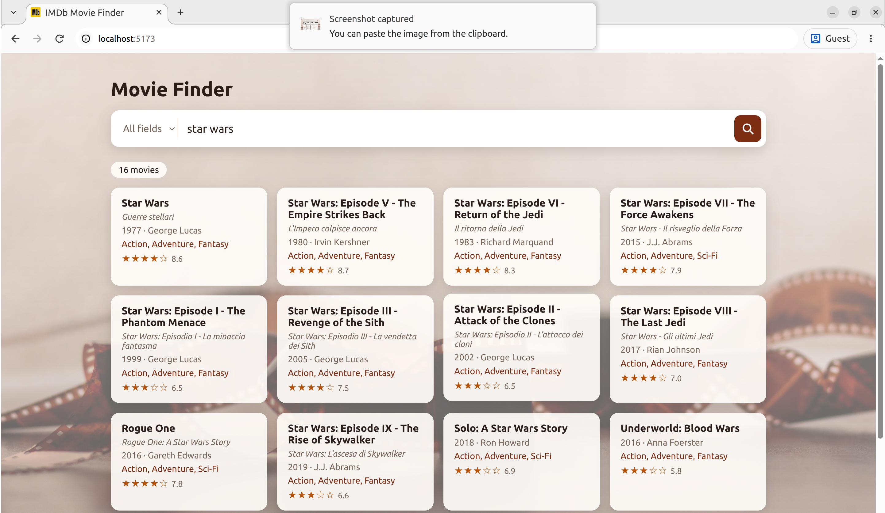

# Movie Finder

[](https://github.com/marialaraa/MoviesIMBd/actions/workflows/tests.yml)

Fullstack IMDb movie viewer: a Flask + Postgres API with typo- and accent-tolerant search, and a React frontend.

<p align="center">
  
</p>

```
backend/      Flask API (app/), tests (tests/)
frontend/     React app (Vite)
notebooks/    Dataset exploration and cleaning
```

## Quick start

**Dataset (needed by both options).** The movies CSV is not in the repo; any file with the IMDb dataset's columns works.
Set its path in `RAW_PATH` (first cell of `notebooks/DataExploration.ipynb`) and run the notebook (Python with pandas and Jupyter):
it corrects malformed values (e.g. `year = "TV Movie 2019"`, or integers stored as `"99.0"`) and writes a copy next to it with a `_clean` suffix (`movies.csv` → `movies_clean.csv`).

On every start, the backend loads that CSV into Postgres, replacing previous data.

### Option A: Docker (run everything)

Requirements: Docker. From the project root:

```bash
MOVIES_CSV=path/to/movies_clean.csv docker compose up --build
```

`MOVIES_CSV` defaults to `IMDb_movies_clean.csv` in the project root. Once the API finishes loading:

- App: http://localhost:8080
- API: http://localhost:5000
- Postgres: `localhost:5432` (user, password and database: `movies`)

Stop with `Ctrl+C`, or `docker compose down`.

### Option B: Local development

Requirements: Docker (only for Postgres), Python 3.14, Node 22. Code changes reload automatically.

**1. Database**

```bash
docker compose up -d db
```

**2. Backend** → http://localhost:5000

```bash
cd backend
pip install -r requirements.txt
python run.py --csv path/to/movies_clean.csv --debug
```

Options: `--csv` (or `MOVIES_CSV`), `--database-url` (or `DATABASE_URL`), `--host`, `--port` (default `5000`), `--debug` (auto-reload).

With `--debug`, Flask's reloader runs the app in a child process that restarts on every code change,
so the CSV is loaded twice on start and again after each change. Leave it off when you don't need auto-reload.

**3. Frontend** → http://localhost:5173

```bash
cd frontend
npm install
npm run dev
```

The dev server forwards `/api/*` to the backend on port 5000; in Docker, nginx does the same.

## Frontend

Search bar on top (choose a field or "All fields"), results as cards below that update as you type, with pagination.
Clicking a card opens the movie's full details.

**Titles.** Cards and details show the movie's **original title** (`original_title`) first, since it's the one people recognize.
Below it, in smaller text, they show the CSV's `title`, in whatever language the dataset uses (in this IMDb dataset, the Italian release title),
only when it differs from the original: *The Godfather* / *Il padrino*.

## API

| Endpoint | Description |
|---|---|
| `GET /` | HTML page listing the endpoints, with clickable examples |
| `GET /movies` | Paginated list, optionally filtered. Summary fields only (id, titles, year, genre, director, rating, votes) |
| `GET /movies/<imdb_title_id>` | One movie with every column (description, cast, budget...); `404` if not found |
| `GET /health` | `200` if the database answers, `503` if not |

`/movies` query parameters:

| Param | Description |
|---|---|
| `title` | Filter by title: the dataset's `title` is the Italian release title, so this also searches `original_title` |
| `original_title`, `director`, `writer`, `actors`, `genre` | Filter by that field |
| `year` | Exact year |
| `q` | Any of the fields above |
| `page`, `limit` | Pagination (default `1` and `20`, max `limit` `100`) |

How text search works:

- Case and accents are ignored: `amelie` finds *Amélie*.
- **Every word** must match. How strictly depends on its length:
  - 1–2 characters (`IX`, `1`): must appear as a **whole word**, so `IX` doesn't match inside "Nixon".
  - 3–4 characters (`star`, `pulp`): must be **contained** as typed (`%` and `_` are literal characters).
  - 5+ characters (`matrx`, `tarantno`): contained or **similar**, so typos are tolerated.
- With `q`, each word can match a different field.
- Several filters combine with AND. Best matches come first, then the most voted.
- Invalid `page`, `limit` or `year` → `400` with `{"error": "..."}`.

| Search | Finds | Why |
|---|---|---|
| `title=matrx` | *The Matrix* | typo in a word |
| `title=pulp fictin` | *Pulp Fiction* | each word matches, one with a typo |
| `title=pulp fiction z` | nothing | there's no word `z` in the title |
| `q=star wars ix` | *Star Wars: Episode IX* | `IX` is a whole word only in that title |
| `q=star wars x` | nothing | no Star Wars title has the word `X` |
| `q=tarantino pulp` | *Pulp Fiction* | `tarantino` matches the director, `pulp` the title |

### Using the API with curl

With the backend running on port 5000. Responses are abbreviated (`...`).

**List movies** (most voted first, 20 per page):

```bash
curl "localhost:5000/movies"
```

```json
{
  "total": 85855, "page": 1, "limit": 20,
  "results": [
    {"imdb_title_id": "tt0111161", "title": "Le ali della libertà", "original_title": "The Shawshank Redemption",
     "year": 1994, "genre": "Drama", "director": "Frank Darabont", "avg_vote": 9.3, "votes": 2278845},
    "..."
  ]
}
```

**Filter by title** (contains, case- and accent-insensitive, tolerates typos):

```bash
curl "localhost:5000/movies?title=godfather"
curl "localhost:5000/movies?title=matrx"
```

**Other fields, combined filters, any field, pagination:**

```bash
curl "localhost:5000/movies?director=tarantino"
curl "localhost:5000/movies?title=pulp&director=tarantino"
curl "localhost:5000/movies?q=amelie"
curl "localhost:5000/movies?year=1999&page=2&limit=50"
```

**One movie:**

```bash
curl "localhost:5000/movies/tt0133093"
```

```json
{"imdb_title_id": "tt0133093", "title": "Matrix", "original_title": "The Matrix", "year": 1999, "director": "Lana Wachowski, Lilly Wachowski", "...": "..."}
```

**Errors:**

```bash
curl "localhost:5000/movies?page=abc"        # 400 {"error": "'page' must be a positive integer"}
curl "localhost:5000/movies?year=nineteen"   # 400 {"error": "'year' must be a number"}
curl "localhost:5000/movies/tt0000000"       # 404 {"error": "movie 'tt0000000' not found"}
```

**Health check:**

```bash
curl "localhost:5000/health"                 # 200 {"status": "ok", "database": "ok"}
```

Add `-i` to any command to see the HTTP status code, e.g. `curl -i "localhost:5000/movies/tt0000000"`.

## Tests

```bash
cd backend
pytest                                                             # needs Postgres: docker compose up -d db
pytest --check-routes --cov=app --cov-report=term-missing --cov-fail-under=90   # same checks as CI
```

- They run against a separate `movies_test` database (created automatically) with `tests/movies_sample.csv`, 7 movies chosen to cover each case.
- GitHub Actions runs them on every push and pull request, and fails if a test fails,
  if any route is never called by a test, or if coverage drops below 90%.

## Design notes

- **Fuzzy search in Postgres.** Each word of a text filter is `ILIKE '%word%'` (plain "contains") `OR` `pg_trgm` word similarity (typos),
  both served by a GIN trigram index per field. Matching word by word (all words required) keeps typo tolerance
  without letting an extra word slip through just because the rest of the text is similar.
  Typo tolerance is limited to words of 5+ letters: on shorter words a 0.6 similarity is reached by unrelated words
  (`wars` ≈ genre `War`), which flooded "All fields" searches with noise.
- **Accents.** Query and fields go through `unaccent`, wrapped in an `IMMUTABLE` function so it can be indexed.
- **Validation, not cleaning.** Data cleaning lives in the notebook; the API validates the CSV and refuses to start
  if it contains malformed values, instead of guessing how to correct them.
- **Pagination in SQL**, since returning 85k movies at once would be tens of MB.
- **Light lists, full details on demand.** `/movies` only returns the fields a card shows; the frontend fetches `/movies/<id>`
  when a card is opened. Searches wait 300 ms after typing stops and cancel the previous request.

## Scope: local development only

The Docker setup already serves both apps from one origin (nginx proxies `/api/`), so no CORS is needed.
Production would also need: a WSGI server (e.g. `gunicorn`) instead of Flask's dev server, HTTPS (TLS certificate),
real database credentials, validation that doesn't rely on `assert`, and loading the CSV as a separate step instead of on every start.
